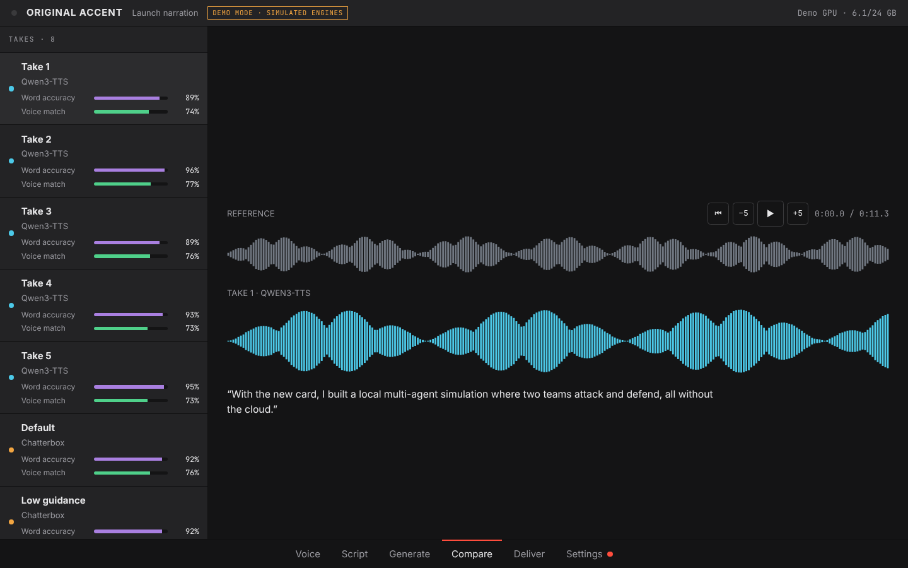
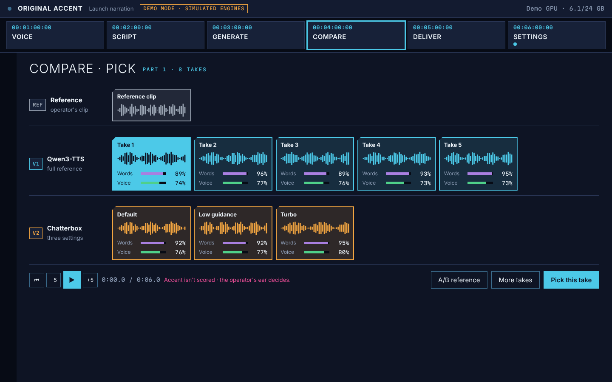
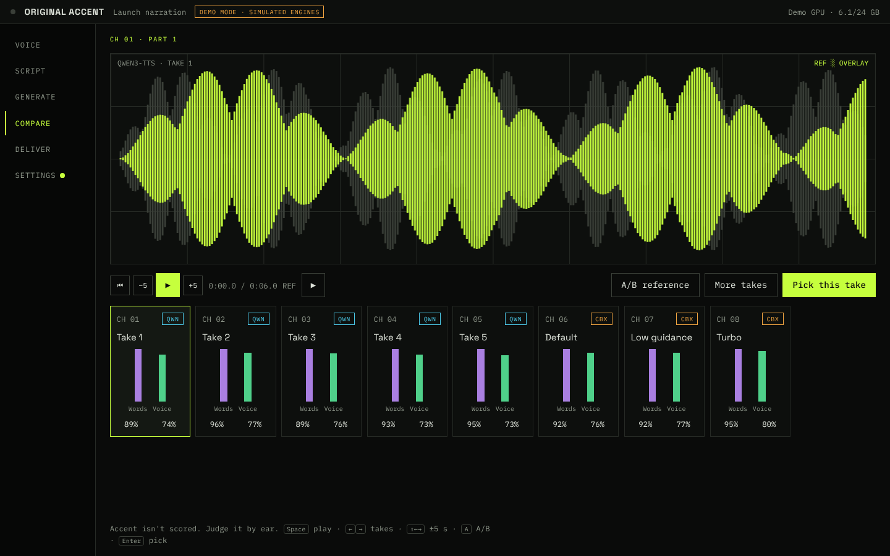
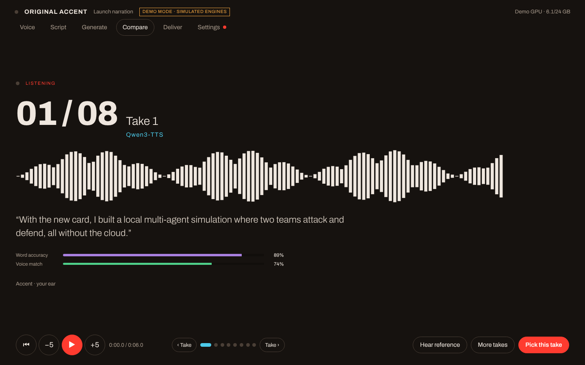

# Original Accent

**Local voice cloning that keeps the speaker's accent.**

Original Accent is a Windows desktop app for cloning a voice from a short recording and having it speak your script, **without flattening the speaker's accent**. It started as a way to voice non-native English speakers, such as Taiwanese English, in product videos without them sounding generic.

It isn't a new voice model. It's a front end and workflow built around open models made by others, chiefly [Qwen3-TTS](https://github.com/QwenLM/Qwen3-TTS) from Alibaba's Qwen team, with [Chatterbox](https://github.com/resemble-ai/chatterbox) from Resemble AI as an optional second engine. What it adds:
- an installer that sets the models up properly on your GPU;
- picking the cleanest part of a recording;
- generating several takes;
- comparing them by ear against the original;
- splitting long scripts and joining the results.

**Everything runs on your own PC. Nothing is sent to a cloud service.**

> **Status: beta (0.3).** It has been used in real video work, but only tested on one machine (Windows 11, RTX 4090). Expect rough edges, and please report them.


<sub>Screenshots are from the app's demo mode, which simulates the engines, so the waveforms are placeholders.</sub>

## What it does
1. **Voice.** Add a recording of the speaker: audio or video, up to 3 hours. Original Accent picks the cleanest 6–15 seconds to clone from, and you can move the section if you prefer another part. Whisper drafts the transcript, which you correct word for word.
2. **Script.** Paste what the voice should say. Long scripts can be auto-split at paragraph and sentence ends.
3. **Generate.** Qwen3-TTS makes five takes per part by default. Chatterbox can add three more, made a different way.
4. **Compare.** Listen to each take, switch between it and the original recording, scrub through it, and pick one. Each take shows a word-accuracy and voice-match score as a hint. Accent isn't scored: your ear decides.
5. **Deliver.** Export each pick as a named WAV, and optionally one joined file with matched loudness and natural pauses.

Four interface skins are included (Grade, Reel, Signal, Booth), along with an interface-size setting that works on top of Windows display scaling.

| Grade | Reel | Signal | Booth |
|---|---|---|---|
|  |  |  |  |

## Compatibility

| | Status |
|---|---|
| Windows 11 | **Tested** |
| Windows 10, 64-bit | Expected to work, not yet tested |
| NVIDIA RTX 40 series | **Tested** (RTX 4090, 24 GB) |
| NVIDIA RTX 30 series | Expected to work, not yet tested |
| NVIDIA RTX 50 series | Qwen3-TTS and Whisper expected to work. **Chatterbox likely won't**: it needs PyTorch 2.6, which has no build for these cards. |
| NVIDIA RTX 20 / GTX 16 and older | Uncertain: Qwen3-TTS runs in bfloat16, which these cards don't support natively |
| Video memory | Engines run one at a time. 8 GB is probably enough for Qwen3-TTS alone (untested); 24 GB is tested. |
| AMD or Intel graphics, or CPU only | Not supported: the engines need NVIDIA CUDA |
| macOS | Not yet. A Mac version looks possible on Apple Silicon but hasn't been built or measured. |
| Linux with NVIDIA | Runs from source in principle; untested |
| Recordings in | Anything ffmpeg reads (WAV, MP3, M4A, FLAC, MP4, MOV, MKV…), up to 3 hours or 4 GB |
| Audio out | WAV, 24 kHz mono |
| DaVinci Resolve | Studio (direct) and free (a few steps by hand); see below |
| Language | English. Qwen3-TTS supports nine more languages, which the app doesn't offer yet. |
| Disk space | About 30–40 GB for engines and models |
| Internet | Needed to install and download engines; afterwards it works offline |

## Install
1. Download **OriginalAccent-Setup-x.y.z.exe** from [Releases](../../releases).
2. Run it. No admin rights are needed, and it installs for your Windows user only. Choose your engines:
   - **Qwen3-TTS** is required.
   - **Whisper + speaker check** is recommended.
   - **Chatterbox** is optional.
3. When the app first opens, it downloads the engines you chose, showing progress on each engine's row. This is a one-time download of several gigabytes.

The installer isn't code-signed yet, so Windows SmartScreen may say "Windows protected your PC". Choose **More info → Run anyway**. Every release is built by GitHub Actions from the source in this repository; see [`.github/workflows/release.yml`](.github/workflows/release.yml).

To uninstall, use Windows **Settings → Apps → Original Accent**. It asks whether to keep your voices and downloaded engines.

## Long scripts
Each part is spoken in one go. Qwen3-TTS manages about 2½ minutes (around 350 words) per part, and Chatterbox about 40 seconds (around 90 words). Auto-split breaks longer scripts at paragraph ends first, then sentence ends. Every chunk is cloned from your original recording, so voice, timbre and accent carry through. Pace, energy and loudness can vary between chunks, though, which you'd hear at the joins. The app explains this and helps you listen through the joins before exporting.

## DaVinci Resolve
Original Accent can work with DaVinci Resolve in both directions:
- **Voice from a clip:** take the clip selected in the Media Pool (using its In and Out marks) or the clip under the playhead (using the part in the edit). No hunting for the original file.
- **Script from markers:** put a marker where each line should go, with the line in the marker's note. Each note becomes a part, and remembers its position.
- **Send to Resolve:** picked takes go into an *Original Accent* bin. They can also go on new audio tracks, starting at the playhead or back at their markers. Your existing tracks are never touched.

Choose how to connect in **Settings → DaVinci Resolve**:

| | Resolve Studio | Resolve (free) |
|---|---|---|
| Voice from a clip | Selected clip or clip at playhead, one click | Drop the clip's file in |
| Script from markers | One click | Export **Timelines → Export → Timeline Markers to EDL** in Resolve, then choose that file |
| Takes into the edit | One click | Paste one line the app gives you into **Workspace → Console**, then press *It's done* |
| Setup | In Resolve, set **Preferences → System → General → External scripting using** to **Local** | Choose *Resolve (free)* in Settings |

From Resolve 21.1, outside programs can't control the free edition, and scripts in its Console can read files but not save them, which is why the free route has steps by hand. **Status:** takes into the edit has been confirmed on Resolve 21.1.1 (free). The rest is built against Resolve's documented scripting API and tested with a simulated Resolve; please report anything that misbehaves.

## Responsible use
Voice cloning can be misused. Original Accent asks you to confirm you have the speaker's permission before adding any recording, and keeps that confirmation with the voice. Please:
- only clone voices you have clear permission to use;
- don't use cloned voices to deceive, impersonate, or put words in someone's mouth;
- label AI-generated voice where your audience would reasonably expect to know.

**Watermark:** everything Chatterbox generates carries Resemble AI's inaudible Perth watermark, so it can be identified as AI-generated. Qwen3-TTS output isn't watermarked by the model.

## Privacy
- No accounts, no telemetry, no analytics.
- Your recordings, scripts and takes stay on your PC, in `%LOCALAPPDATA%\OriginalAccent`.
- The app connects to the internet only to download engines and models, and for an optional daily check that fetches version numbers from PyPI and Hugging Face. You can switch the check off in Settings.

## Credits
Original Accent stands on other people's work:
- **Qwen3-TTS** by the Qwen team at Alibaba Cloud, the voice engine (Apache-2.0).
- **Chatterbox** by Resemble AI, the second engine (MIT).
- **Whisper** by OpenAI (MIT), and **SpeechBrain**'s speaker-verification model (Apache-2.0), the checks.
- PyTorch, Hugging Face, pywebview, FFmpeg, uv, NSIS, and the six open-source typefaces used by the skins.

The full list with licences is in [THIRD_PARTY_NOTICES.md](THIRD_PARTY_NOTICES.md).

## How it was made
Original Accent was designed and directed by Rajinder Gill and written with **Claude** (Anthropic's AI) as the coding assistant. Rajinder set the requirements, made the design and product decisions, tested it on real work, and judged every take by ear. Claude wrote the code to that direction. The development notes are in [docs/HANDOFF.md](docs/HANDOFF.md).

## Running from source
```
pip install -r requirements.txt
python -m original_accent              # the app window
OA_DEMO=1 python -m original_accent --browser   # simulated engines: work on the UI without a GPU
```
To build the installer: `installer/build.sh` (needs [NSIS](https://nsis.sourceforge.io); fetches uv itself). See [CONTRIBUTING.md](CONTRIBUTING.md).

## Licence
[MIT](LICENSE) © 2026 Rajinder Gill. This covers Original Accent's own code. The engines and models it downloads have their own licences; see [THIRD_PARTY_NOTICES.md](THIRD_PARTY_NOTICES.md).
